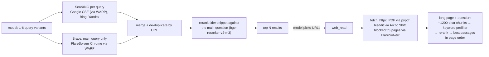

# websearch-mcp

Self-hosted web search for local LLMs. It is a stdio MCP server, so it works in any harness (Copilot, Codex, opencode, …).

- No API keys, no accounts, no paid services.
- Runs on your machine: SearXNG, FlareSolverr (a real Chrome) and a free Cloudflare WARP exit run in Docker. A cross-encoder reranker runs on the CPU.

## Tools

- **`web_search(queries, time_range?, max_results?)`**
  - Searches Google, Bing, Yandex and Brave, then merges the results and reranks them.
  - Returns the top results with their title, URL, date, which engines found them, and a snippet.
- **`web_read(url, question?, max_chars?)`**
  - Turns a page, PDF or Reddit thread into clean markdown.
  - Long pages are cut down to the passages most relevant to `question`.

## How it works



The server does not read pages on its own. The model reads the ranked list and calls `web_read` on the URLs it wants. This is the same search-then-read loop that hosted assistants use.

**Rate limits**

- Google and Brave rate-limit a home IP quickly, so both go out through the WARP container. Yandex and Bing connect directly.
- After a Brave captcha, Brave is paused for 1 hour. The pause is stored in `/tmp/websearch-brave-paused-until`; delete that file to retry sooner.
- If a date-filtered search comes back empty, it is retried without the filter. Those results are labelled `NOT date-filtered`.

## Requirements

- Linux with Docker and Docker Compose. The WARP container needs `NET_ADMIN`.
- [uv](https://docs.astral.sh/uv/). The Python dependencies are declared inline in `websearch.py` (PEP 723).
- About 600 MB of disk for the reranker model. It downloads on first use to `~/.cache/fastembed`; set `FASTEMBED_CACHE_PATH` to change the location.

## Setup

```sh
git clone https://github.com/aviv0404/websearch-mcp && cd websearch-mcp
./mcp-wrapper.sh </dev/null   # first run: creates .env and starts the containers
./websearch.py --selfcheck    # live smoke test
```

Register `mcp-wrapper.sh` as a stdio MCP server; it takes no arguments or environment variables. It does three things:

1. Creates `.env` with a random SearXNG secret on first run.
2. Runs `docker compose up -d`. This is idempotent, and harnesses share the same containers.
3. Waits for SearXNG to answer, then starts the server.

**GitHub Copilot CLI / app** (`~/.copilot/mcp-config.json`):

```json
{ "mcpServers": { "websearch": { "type": "local", "command": "/path/to/mcp-wrapper.sh", "args": [], "tools": ["*"], "timeout": 120000 } } }
```

**Codex** (`~/.codex/config.toml`):

```toml
[mcp_servers.websearch]
command = "/path/to/mcp-wrapper.sh"
```

**opencode v2** (`~/.config/opencode/opencode.jsonc`):

```jsonc
"websearch": false,  // turn off the built-in cloud search
"mcp": { "servers": { "websearch": { "type": "local", "command": ["/path/to/mcp-wrapper.sh"], "codemode": false } } }
```

**Tips**

- Turn off a harness's built-in web search so the model uses this one.
- Local models do better with direct tools. In opencode, set `codemode: false`.

## Files

- `websearch.py`: the MCP server.
- `mcp-wrapper.sh`: the entry point that starts the containers, then the server.
- `docker-compose.yml`: SearXNG, FlareSolverr and WARP. Ports are bound to 127.0.0.1 only.
- `settings.yml`: SearXNG engine selection. Engines that only returned captchas are disabled.
